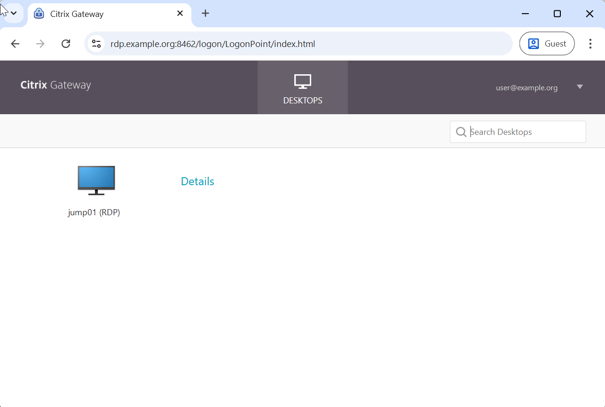
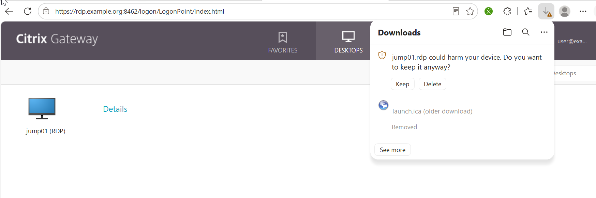
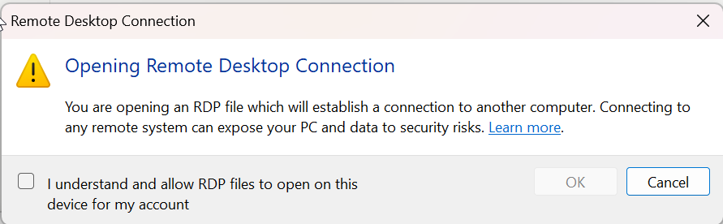
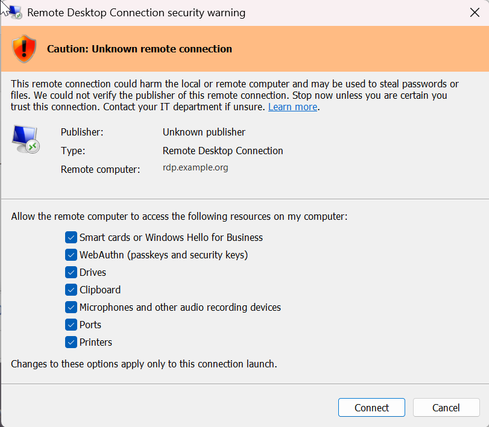
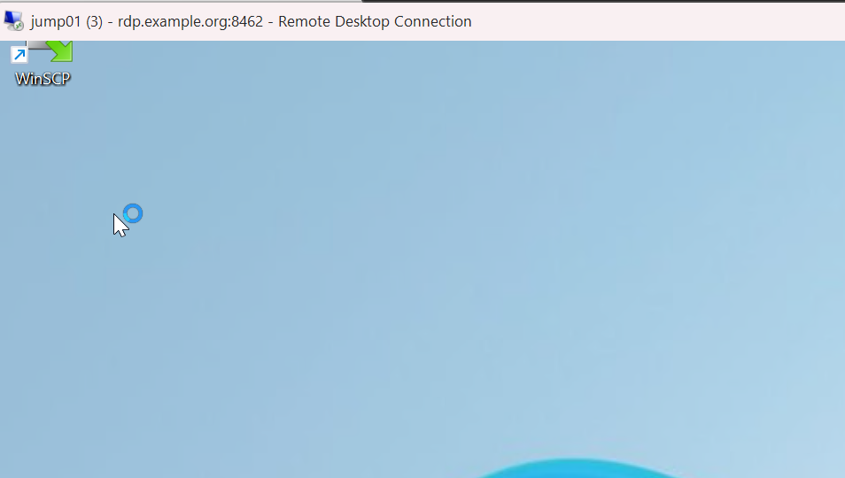
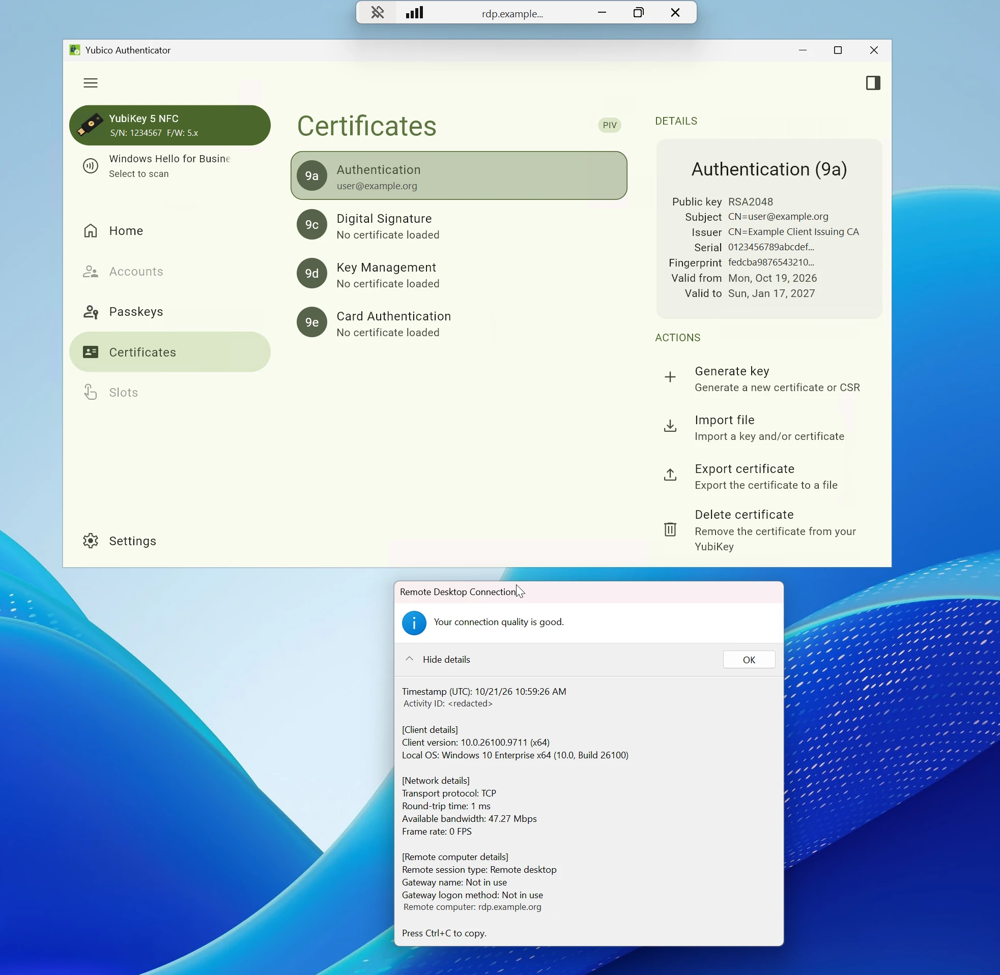
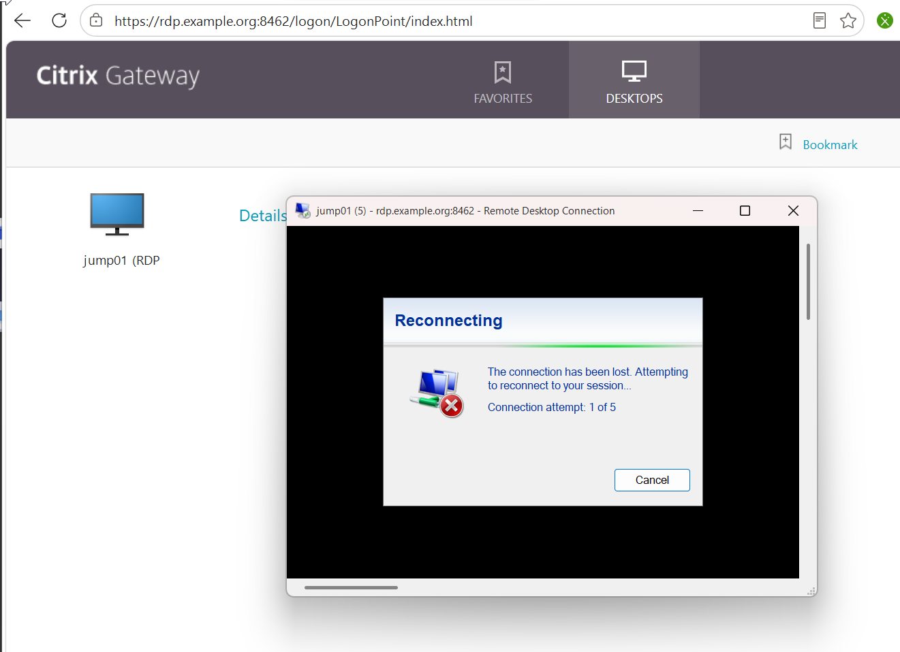

# netscaler-rdp-proxy-oidc

An **RDP-only admin Gateway** on NetScaler (Citrix ADC) 14.1: users log in with **OIDC** (Entra ID as the
example, any OIDC IdP works the same way), get a portal with exactly one RDP bookmark, and `mstsc` connects to the
**Gateway** - NetScaler RDP Proxy forwards to the jump host. The jump host is never reachable from outside, and only
one TCP port is published.



## Flow
```
Browser ──https://rdp.example.org:8462──> gw_rdp (NetScaler)
   │  nFactor: OIDC login (dedicated app, assignment required, Conditional Access per app)
   │  portal (theme th_rdp = RfWebUI without Favorites, clientless, no ICA) -> bookmark "jump01 (RDP)"
   └─ click -> jump01.rdp (points to rdp.example.org:8462, NOT to the jump host)
mstsc ──TLS, same port 8462──> RDP Proxy ──3389──> jump01.example.org
   └─ Windows logon on the jump host with the AD admin account (OIDC gives NetScaler no AD password - intended)
```
Default **DENY**; two allow rules (HTTP `/rdpproxy/<target>` + TCP target:3389) bound to an AAA group that every
OIDC user of this Gateway lands in. Redirections (clipboard, drives, printers, smart cards, ...) per client profile.

## Screenshots
Windows 11 client against NetScaler 14.1 - names and IDs replaced by placeholders. More (incl. the errors on the
way) in [`docs/SCREENSHOTS.md`](docs/SCREENSHOTS.md).

<table>
<tr>
<td width="50%"><a href="docs/screenshots/06-browser-download-rdp-file.png"></a><br><sub><b>1.</b> The bookmark downloads <code>jump01.rdp</code> (pointing to the Gateway, not to the jump host)</sub></td>
<td width="50%"><a href="docs/screenshots/07-mstsc-open-rdp-file-warning.png"></a><br><sub><b>2.</b> Windows 11 warns before opening any <code>.rdp</code> file (one-time opt-in per user)</sub></td>
</tr>
<tr>
<td><a href="docs/screenshots/11-mstsc-all-redirections-on.png"></a><br><sub><b>3.</b> Unsigned file: the user ticks the redirections - "Remote computer" is the Gateway</sub></td>
<td><a href="docs/screenshots/15-session-via-gateway.png"></a><br><sub><b>4.</b> Session on the jump host through the single Gateway port 8462</sub></td>
</tr>
<tr>
<td><a href="docs/screenshots/16-smartcard-redirected-connection-info.png"></a><br><sub><b>5.</b> Smart card (YubiKey) redirected; connection info shows TCP and "Gateway name: Not in use"</sub></td>
<td><a href="docs/screenshots/17-ha-failover-reconnecting.png"></a><br><sub><b>6.</b> HA failover: mstsc auto-reconnect fails - new portal login + new <code>.rdp</code> brings back the same Windows session</sub></td>
</tr>
</table>

## Contents
| Path | |
|---|---|
| [`nitro/rdp-gateway.json`](nitro/rdp-gateway.json) | complete NetScaler config as a [netscaler-nitro](https://github.com/bensplittgerber/netscaler-nitro) `Deploy-NsObjects.ps1` file - placeholders |
| [`theme/th_rdp/`](theme/th_rdp) | portal theme files (RfWebUI based): hide Favorites + personal bookmarks, start on Desktops |
| [`docs/ENTRA.md`](docs/ENTRA.md) | Entra app registration + **Conditional Access policy per app** (MFA, sign-in frequency every time) via Microsoft Graph PowerShell |
| [`docs/GOTCHAS.md`](docs/GOTCHAS.md) | everything that is not (or wrongly) in the docs - found the hard way on 14.1 |
| [`docs/SCREENSHOTS.md`](docs/SCREENSHOTS.md) | the flow and the errors on the way, as screenshots |

## Requirements
- NetScaler **14.1** (verified on 14.1 build 73.46, Express/freemium license - RDP Proxy is included), standalone or HA.
- A VIP + a public name (`rdp.example.org`), one firewall/NAT rule **TCP** 8462 -> VIP (no UDP needed).
- A server certificate for the name (e.g. Let's Encrypt via [netscaler-acme](https://github.com/bensplittgerber/netscaler-acme)).
- An existing frontend SSL profile (`ssl_prof_frontend` in the template, TLS 1.2/1.3).
- OIDC app registration (see `docs/ENTRA.md`), RDP enabled on the jump host (NLA), admin users allowed to log on via RDP.

## Deploy
1. Replace the placeholders in `nitro/rdp-gateway.json`: `ns01.example.org`, `rdp.example.org`, `192.0.2.10`,
   `jump01.example.org` / `192.0.2.20`, `<TENANT_ID>`, `<CLIENT_ID>` (and names/redirections to taste).
2. PowerShell 7 with [netscaler-nitro](https://github.com/bensplittgerber/netscaler-nitro) next to this repo:
```powershell
$env:OIDC_RDP_CLIENT_SECRET = Read-Host 'OIDC client secret' -MaskInput
$env:RDP_PSK = -join ([Security.Cryptography.RandomNumberGenerator]::GetBytes(16) | % { $_.ToString('x2') })   # never shown
$cred = Get-Credential nsroot
..\netscaler-nitro\scripts\Deploy-NsObjects.ps1 -ConfigFile .\nitro\rdp-gateway.json -Credential $cred -WhatIf
..\netscaler-nitro\scripts\Deploy-NsObjects.ps1 -ConfigFile .\nitro\rdp-gateway.json -Credential $cred
Remove-Item Env:OIDC_RDP_CLIENT_SECRET, Env:RDP_PSK
```
3. Copy the portal theme files - NITRO only creates the empty theme `th_rdp` (to the primary; HA syncs the theme
   directory to the secondary, verified on 14.1 73.46):
```powershell
scp .\theme\th_rdp\css\theme.css nsroot@ns01.example.org:/var/netscaler/logon/themes/th_rdp/css/theme.css
scp .\theme\th_rdp\script.js     nsroot@ns01.example.org:/var/netscaler/logon/themes/th_rdp/script.js
```
4. Bind the server certificate to `gw_rdp` **and** `aaa_gw_rdp`; the Gateway goes UP.
5. Create the Conditional Access policy (report-only first, then enable) - `docs/ENTRA.md`.

The PSK only signs the RDP connection between the Gateway and its RDP listener - nobody needs to know it; a
redeploy simply generates a new one. Neither secret is written to disk.

## Test
- Browser login -> portal opens on **Desktops** (no Favorites tab, Details shows only "Open") -> `jump01.rdp` ->
  mstsc -> session on the jump host.
- Windows shows **"Unknown publisher"** and unticks **all redirections** on the first launch of an unsigned `.rdp`
  file - the user opts in per launch (NetScaler cannot sign `.rdp` files).
- Smart card redirection: YubiKey visible inside the session (e.g. Yubico Authenticator).
- Negative: a user without the app assignment is rejected by the IdP.
- With the CA policy enabled: an existing IdP session in the browser still asks for MFA.
- HA failover during a session: mstsc auto-reconnect fails (the Gateway session is not carried over to the
  secondary, the .rdp cookie is short-lived). A fresh browser login alone does not revive the old mstsc window -
  it keeps presenting the token from the old `.rdp` file. Log in again, **download the `.rdp` again**, and the user
  lands in the same Windows session.

## Limitations / notes
- **Two separate gates:** NetScaler decides who may *reach* the jump host (OIDC user, MFA, RDP to that host only). The
  Windows logon inside the RDP stream (any account valid on the jump host, e.g. a separate admin account) is checked by
  Windows/AD alone - NetScaler cannot see or bind it (OIDC gives NetScaler no AD password, so no SSO). To bind both:
  nFactor OIDC + LDAP factor with RDP proxy SSO. **Entra authentication for RDP (`enablerdsaadauth`) does not work
  through the proxy:** Microsoft requires the connection name to match the target device name in Entra ID, but mstsc
  connects to the Gateway name.
  Practical hardening: allow RDP on the jump host **only from the NetScaler SNIP** and correlate the NetScaler log
  (IdP user) with Windows event 4624 (account, source = SNIP).
- Windows Hello / smart card **logon** to the jump host is a Windows topic (WHfB trust, NTAuth), not NetScaler.
- Without a per-app Conditional Access policy an existing IdP browser session logs in **silently** (no MFA prompt).

## License
MIT - see [LICENSE](LICENSE).
