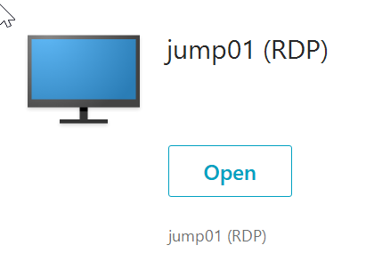
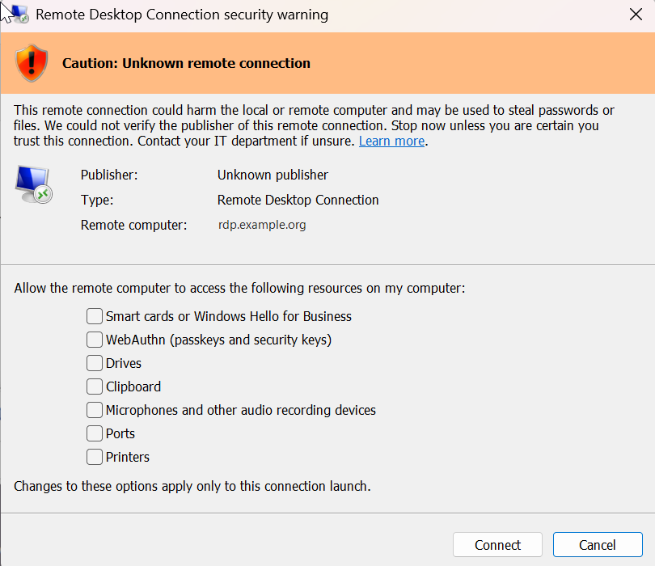
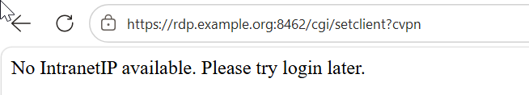
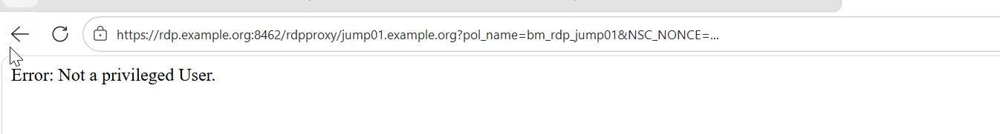

# Screenshots

Taken during the build on NetScaler 14.1 (Windows 11 client). Names, addresses, serial numbers and IDs are replaced
by placeholders (`rdp.example.org`, `jump01`, `user@example.org`).

## Working flow
| Step | |
|---|---|
| Portal (theme `th_rdp`, RfWebUI based, clientless): opens on Desktops with the single bookmark, no Favorites tab |  |
| Details of the bookmark: only "Open" - "Add To Favorites" is hidden (blocked by the firmware, GOTCHAS #10) |  |
| Click on the bookmark downloads `jump01.rdp` - the browser flags `.rdp` files as potentially harmful ("Keep") |  |
| Windows 11 warns before opening any `.rdp` file (one-time opt-in per user account) |  |
| Unsigned `.rdp`: "Unknown publisher", Windows unticks all redirections on the first launch |  |
| The user opts in to the redirections (per launch) - "Remote computer" is the **Gateway** |  |
| Session on the jump host through the Gateway port (window title) |  |
| Smart card (YubiKey) redirected into the session; connection info: TCP, "Gateway name: Not in use" - RDP Proxy is transparent for mstsc |  |
| HA failover during the session: mstsc tries to reconnect and fails (the Gateway session is not carried over); a new portal login + a **new** `.rdp` download lands in the same Windows session (the old mstsc window cannot reuse the new login) |  |

## Errors on the way (see [GOTCHAS.md](GOTCHAS.md))
| Error | Gotcha | |
|---|---|---|
| "No IntranetIP available" at `/cgi/setclient?cvpn` | #4 `usemip NS` + `useiip OFF` |  |
| "Not a privileged User" at `/rdpproxy/<target>` | #5 authorization also on the HTTP request |  |
